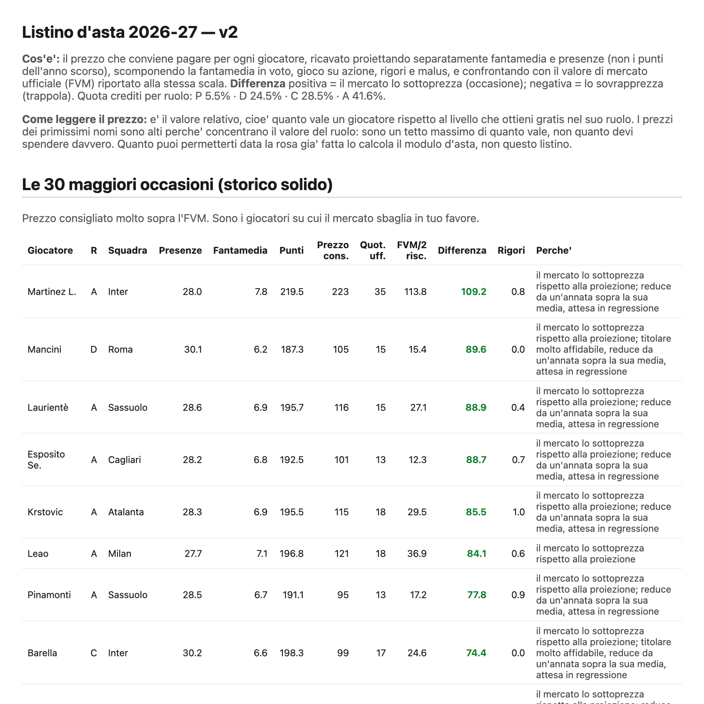

**English** | [Italiano](README.it.md)

# Fantacalcio Analytics

Decision support for a private **fantasy football (Serie A)** league: Classic format, 8 teams, 500 credits, 25-player
squads (3 GK, 8 DEF, 8 MID, 6 FWD), auction held after the 2nd–3rd matchday. The goal is to **price players better
than the official market value (FVM)** under the league's own rules: the edge is relative pricing, not prediction.


<p align="center"></p>

## Why it is interesting

- **Mostly deterministic arithmetic, not machine learning.** About four fifths of the achievable edge come from a
  correct rules engine, budget accounting and constrained squad selection; the remaining fifth is modelling, where
  classical statistics beats complex models.
- **A pure rules engine** (`rules/`): from rating and events to the fantasy score, clean-sheet bonus, goal
  thresholds and team scoring, with a declarative league configuration and pluggable modifiers. Validated with exact
  identities on six seasons of official data.
- **Two-stage projection** (`value/`): the fantasy average is decomposed (rating, open-play contribution, penalties,
  maluses, goalkeeper) and projected separately from expected appearances, with a single calibrated shrinkage.
  Penalty takers are projected by status (volume, conversion, club changes).
- **From value to price:** replacement levels computed on the demand for *starters* (not squad slots), a measured
  credit split per role, and a price list compared with the FVM that flags bargains and traps with the reason for
  each row (`output/listino.html`).
- **Data engineering with loud failures:** six seasons (2020-21 → 2025-26), 2,280 matches with Understat xG joined
  to FBref, calibration of Understat against Opta on 1,950 overlapping matches, joins that must validate
  independently instead of silently succeeding at 72%.

The full method (goals, xG source calibration, validated results, architecture, lessons learned) is documented in
Italian in [`docs/METODO.md`](docs/METODO.md); file schemas and parsing traps in [`docs/DATI.md`](docs/DATI.md).

## Structure

| Path | Contents |
| --- | --- |
| `rules/` | declarative league rules, fantasy-score engine, team scoring with pluggable modifiers |
| `ingest/` | parsers for per-matchday ratings and the fantasy-average components panel |
| `value/` | projections, penalty takers, replacement levels, budget split, price list and HTML/CSV report |
| `tests/` | engine unit tests, acceptance tests on six seasons, price-list invariants |
| `understat_setup.py` | download and calibration of the xG sources |
| `fanta_statistiche.py` | season statistics: formula validation, replacement levels, budget, persistence |

```bash
python3.12 -m venv .venv && source .venv/bin/activate
pip install -e . && pip install pytest
python -m pytest -q          # test suite
python -m value.report       # generates output/listino.csv and output/listino.html
```

## Data

Data are not included: ratings and statistics from Fantacalcio.it and xG from Understat and FBref belong to their
sources. `understat_setup.py` downloads the Understat data; the other files go in `data/raw/` with the names
described in [`docs/DATI.md`](docs/DATI.md). Acceptance tests on the six seasons need these data; the rules-engine
tests do not.

## License

Source-available under the [PolyForm Strict License 1.0.0](LICENSE): you may read the code and run it for
non-commercial purposes; you may not modify, redistribute or use it commercially without written permission.

---

<sub>© 2026 [Mattia Meligeni](https://mattiameligeni.com). Not affiliated with Fantacalcio.it, Understat or FBref.</sub>
